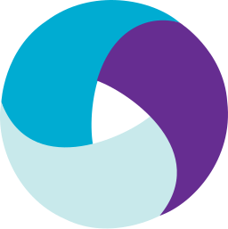
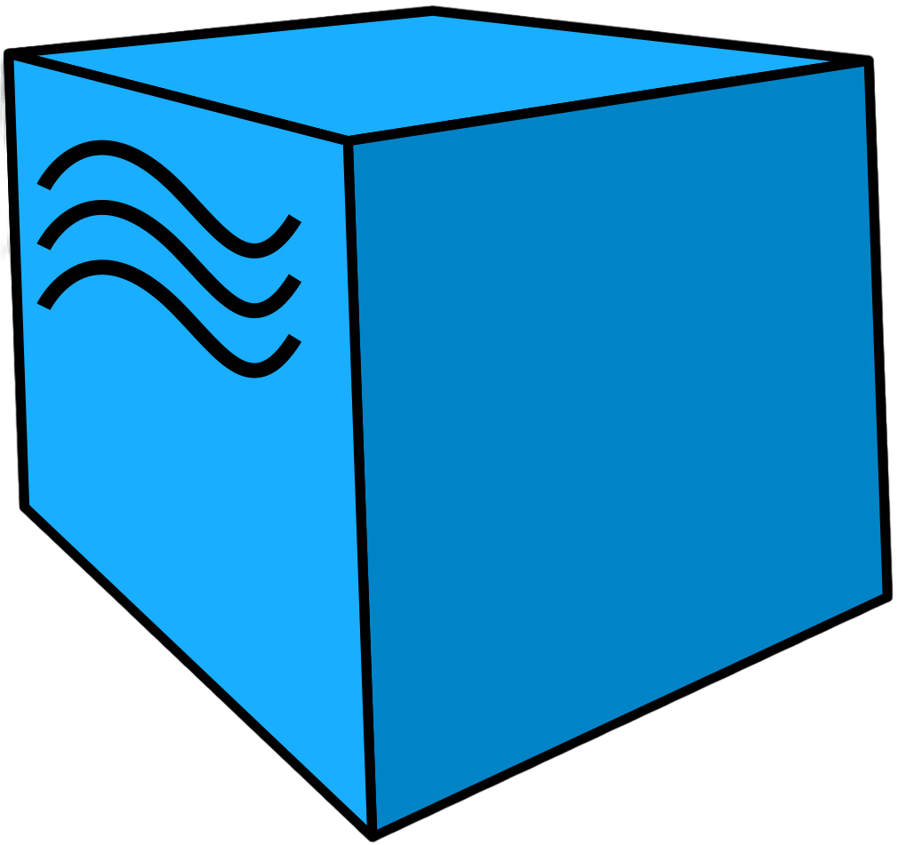
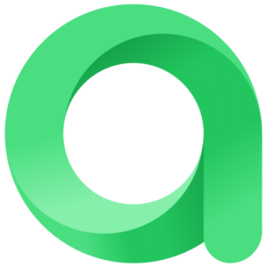
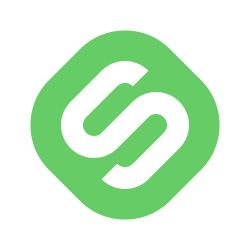

<h1 align="center">Привет, меня зовут <a href="https://github.com/veliseeva/" target="_blank">Вероника</a> 👋</h1>

- 💻 **QA Automation Engineer (Python)**
- 🌍 Языки: Русский (родной), English (B2), Français (B1)

---

  

### 🚀 Мои проекты по автоматизации тестирования

#### 1. <a target="_blank" href="https://github.com/veliseeva/NASA-UI-tests">Фреймворк для UI-автоматизации сайта NASA</a>
- **Стек:** `Python`, `Pytest`, `Selenium`, `Selene`, `Selenoid`, `Jenkins`, `Allure Report`, `Docker`
- **Ключевые решения:** реализован обход WAF и Rate Limiting (Jitter-задержки, подмена заголовков), механизм асинхронного сбора видео из Docker-контейнеров Selenoid (Smart Polling), а также reverse-proxy на Cloudflare Workers для гарантированной доставки уведомлений в Telegram.

#### 2. <a target="_blank" href="https://github.com/veliseeva/Inaturalist_API_and_mobile_tests">Фреймворк для API и Mobile-тестирования iNaturalist</a>
- **Стек:** `Python`, `Pytest`, `Requests`, `Appium`, `BrowserStack`, `Jenkins`, `Allure Report`
- **Ключевые решения:** двухэтапная OAuth2-аутентификация (обмен на JWT), JSON-схемы валидации, запуск мобильных тестов на трех окружениях (эмулятор, реальное устройство, облако BrowserStack) с полной очисткой тестовых артефактов.

---

### 💻 Стек и инструменты

  
  
  
  
  
  
  
  
  
  
  
  
  
  
  
  
  

---

### 🎓 Образование
<table width="100%" border="0">
  <tr>
    <td width="13%" valign="middle"></td>
    <td valign="middle">
      <b>Уральский государственный экономический университет (УрГЭУ)</b> 
      Институт менеджмента и информационных технологий. 
      Институт магистратуры.
    </td>
  </tr>
</table>

### 📚 Дополнительное образование
<table width="100%" border="0">
  <tr>
    <td width="13%" valign="middle"></td>
    <td valign="middle">
      <b>QA Automation Testing</b> — самостоятельное обучение. 
      <b>Manual QA Testing</b> — самостоятельное обучение.
    </td>
  </tr>
  <tr>
    <td width="13%" valign="middle"></td>
    <td valign="middle">
      Курс <a target="_blank" href="https://stepik.org/cert/182436">«Python: основы и применение»</a>. 
      Курс <a target="_blank" href="https://stepik.org/cert/1439721">«Интерактивный тренажер по SQL»</a>.
    </td>
  </tr>
  <tr>
    <td width="13%" valign="middle"></td>
    <td valign="middle">Курс <a target="_blank" href="https://coursera.org/share/ebe245d6f750e1bf2978b38548688421">«Основы программирования на Python»</a>.</td>
  </tr>
</table>

---

### 📬 Связаться со мной
*  <b>Telegram:</b> <a href="https://t.me" target="_blank">@stargazer5621</a>
*  <b>Email:</b> <a href="mailto:vaeliseeva@yandex.ru">vaeliseeva@yandex.ru</a>